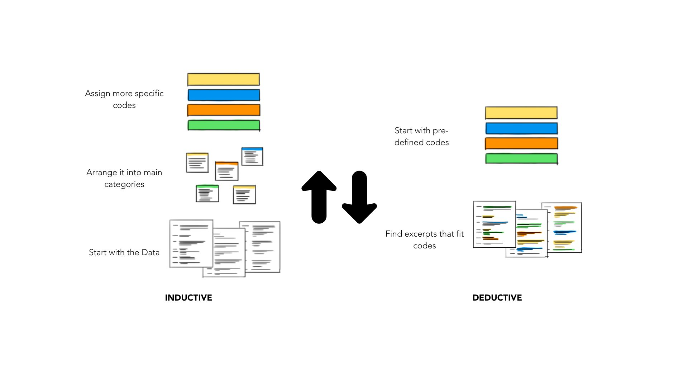
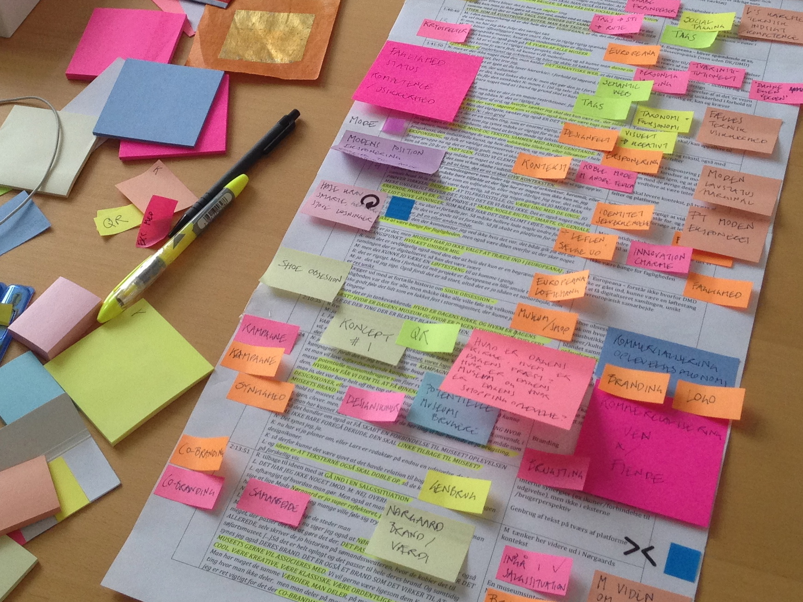

***Our Plan***

| Time | **Block** | **Minutes** | **Focus** | **Hands-on** |
|---------------|---------------|---------------|---------------|---------------|
| 0-10 | [Qualitative Data Analysis] | 10 | What is qualitative coding? Icebreaker | Activity |
|  | [Meet QualCoder!](01-meet-qualcoder.qmd) |  | Tour of basic settings and functionalities. | Activity |
|  | [Setting Up Your Project](02-set-up-project.qmd) |  | Starting a new project and importing files. Describing cases and attributes. | Activities |
|  | Break |  | — | — |
|  | [Coding Data](03-code-your-data.qmd) |  | Working with codes and categories. Different coding approaches. The role of memos. | Activities |
|  | [Analysis and Reporting](04-analyze-report.qmd) |  | Querying data, code retrieval, reports and graphs | Activities |
|  | [AI Features](05-ai-features.qmd) |  | Setting up AI and integrating it into your coding workflow | Discussion |
|  | [Wrapping-up](wrap-up.qmd) |  | Recapping and final considerations | Exit Survey |

## Qualitative Data Analysis {#introduction-warm-up}

### What is Coding?

Qualitative data, such as interview transcripts, open-ended survey answers, field notes and focus group recordings, is rich but unruly. Qualitative analysis is about finding patterns, unfolding both explicit and implicit attitudes, behaviors, and beliefs, understanding meanings, and making sense of findings concerning the research questions at hand.

But how do we move from all that text to meaningful findings? This is where coding comes in. Coding is the process of assigning labels to meaningful parts of our data so we can identify patterns, compare experiences, and develop interpretations. Importantly, coding is not simply highlighting interesting quotes. The way we code influences what we notice, how we interpret people's experiences, and ultimately the conclusions we draw.

A single hour-long interview can run to a couple of pages, and a small-scale study can produce hundreds. Coding is how we turn that volume into something we can think with: we read closely, attach short labels to meaningful segments, and then group, compare and count those labels across the whole dataset. Without coding, analysis tends to rely on whichever quotes felt most vivid; with it, we can see which ideas recur, which are rare, and which participants hold them.

This process involves identifying specific labels applied to small pieces of data. These codes act as foundational building blocks that, when further developed and refined, can combine to form “themes.” Themes are broader concepts that emerge from grouping related codes, offering a deeper interpretation of the data. It is an outcome of coding, categorization, and analytic reflection. In other words, codes provide detailed elements that contribute to the development of broader themes. Coding is the initial step of analyzing data by assigning labels to relevant sections while theming involves interpreting and grouping codes to identify recurring patterns and meanings.

## Inductive vs. Deductive Coding

Data can be arranged and coded following two types of approaches: a more inductive (bottom-up) approach, where insights and themes emerge more organically and directly from the data without prior assumptions, or a deductive (top-down) approach, where researchers apply preexisting theoretical frameworks or concepts to the data. The approaches can also be combined as researchers engage with and learn more details from the data.

{width="567"}

Adapted from: https://delvetool.com/blog/deductiveinductive

The top-down approach begins with a specific theoretical framework or research question. Data collection and analysis are guided by preconceived hypotheses, focusing on confirming or refuting these hypotheses. While it provides more direction to the research process, it may limit alternative perspectives or emergent themes not accounted for in the initial framework. In contrast, the bottom-up approach is exploratory and highly flexible as there are no predetermined categories or hypotheses; it has its basis in grounded theory, meaning that themes emerge directly from the data through open coding and analysis, allowing a wide range of topics and potential unexpected insights to be extracted from the data.

It’s important to remember that, although it’s helpful to understand the differences between these two approaches, they can actually work well together. Combining them allows you to take advantage of each method’s strengths, leading to a richer and more nuanced analysis that incorporates real-world data and theoretical insights.

### Computer-Assisted Qualitative Data Coding

Coding also makes our reasoning visible and accountable, and this is where tools matter. On paper, coding three sentences is manageable; coding 300 pages is not. Renaming a code, finding every passage tagged "trust," comparing two coders, or checking which participants raised an idea all mean flipping through stacks of highlighted pages. Qualitative Data Analysis Software (QDAS) does not do the thinking for us, but it handles the bookkeeping: it stores the codebook, retrieves every coded segment in seconds, merges and renames codes everywhere at once, and links each finding back to its source. That frees our attention for the interpretive work that only a researcher can do.

But why do we need a software? Conducting qualitative data analysis manually or without dedicated tools can quickly become overwhelming. Imagine tracking hundreds of sticky notes, comments, and highlighted passages across dozens of participant documents. As the volume of data grows, it becomes increasingly difficult to keep each insight connected to its original source, remember who said what, compare responses across participants, and identify patterns consistently. Important details can be overlooked, connections can be lost, and verifying interpretations becomes time-consuming. QDAS helps manage this complexity by keeping data organized, searchable, and traceable to its source, allowing researchers to spend less time managing information and more time interpreting meaning.

{width="387"}

### Warm-up

**\<TBD\>-FIXME**

### Setup & Data

The dataset and documentation for this workshop is adapted from a real research project that is publicly archived in the Qualitative Data Repository (QDR):

> Rampin, Vicky; Nguyễn, Sarah. 2020. “Investigating and Archiving the Scholarly Git Experience.” Qualitative Data Repository. <https://doi.org/10.5064/F6VOIB8H>. V2.

The original project, funded by the Alfred P. Sloan Foundation, is a mixed-methods study of how scholars use Git and Git hosting platforms. It draws on focus groups, a survey and interviews. To make the data easier to work with in a short session, we have simplified, trimmed and restructured parts of it.

**Please note:** the adapted version is for teaching only and **should not be used for research or cited as a source.** The original dataset and its documentation in QDR are the official record. If you want to use this data in your own work, please download it directly from QDR and cite the original authors.

\<Download Workshop Materials\>FIXME
