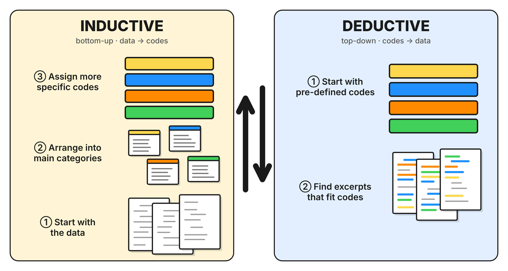

## Qualitative Data Analysis {#introduction-warm-up}

### What is Coding?

Qualitative data, such as interview transcripts, open-ended survey answers, field notes, focus group recordings, videos and news articles, is rich but unruly:

-   **No fixed structure:** Responses wander, contradict themselves or bury the main point.

-   **Inconsistent format:** It spans text, audio and video, and answers range from one word to several paragraphs.

-   **Harder to compare and count:** The same idea shows up in different words, so it has to be interpreted rather than tallied.

-   **Volume:** A few hours of audio recordings or video can fill hundreds of pages.

-   **Ambiguity:** Tone and context carry meaning that’s easy to misread.

Despite these challenges, qualitative data is sometimes the most appropriate, or even the only, way to understand a research phenomenon, depending on what that phenomenon is. For example, a survey can show how many employees are leaving a company, but only interviews can reveal why they decided to go.

Qualitative data analysis is about finding patterns, unfolding both explicit and implicit attitudes, behaviors, and beliefs, understanding meanings and events, and making sense of findings concerning the research questions at hand.

But how do we move from text to meaningful findings? This is where coding comes in. Coding is the process of assigning labels to meaningful parts of our data so we can identify patterns, compare experiences, and develop interpretations. Importantly, coding is not simply highlighting interesting quotes. The way we code influences what we notice, how we interpret people's experiences, and ultimately the conclusions we draw.

A single hour-long interview can run to a couple of pages, and a small-scale study can produce hundreds. Coding is how we turn that volume into something we can think with: we read closely, attach short labels to meaningful segments, and then group, compare and count those labels across the whole dataset. Without coding, analysis tends to rely on whichever quotes felt most vivid; with it, we can see which ideas recur, which are rare, and which participants hold them.

This process involves identifying and labeling meaningful pieces of qualitative data. These labels, called *codes*, help organize the data and make it easier to identify important ideas, concepts, and patterns. Coding is an initial step in qualitative data analysis that supports a closer examination of the data and provides a foundation for further analysis and interpretation.

::: {.callout-note icon="false"}
**Activity 0.1 - Warm-up**

Imagine you’re a researcher studying how new developers experience Git. You’ve just finished an interview, and this is one passage from the transcript. Your job is to read between the lines: what is this person going through, and what’s worth capturing?

> *Interviewer:* Can you tell me about a memorable experience you’ve had using Git?
>
> *Participant:* Sure. In my first internship I merged my feature branch into main and got fourteen conflicts. I kept staring at the angle brackets and equals signs, reading the same lines over and over, and I still couldn’t tell which half was mine and which was my teammate’s. I didn’t even understand why some files had conflicts when I was sure I’d never touched them. So I started googling, and pretty soon I had about twenty tabs open, rebase, reset, revert, cherry-pick, and they all started blurring together. Every answer I found brought up three new terms I’d have to look up, and at some point I was just scrolling without taking anything in. I remember sitting there with the terminal open, not even sure what I was supposed to type next.

**Discuss with a partner or share in the chat**

-   What labels did you both come up with?

-   The participant never says how they *feel*. So how did you know?
:::

### Inductive vs. Deductive Coding

Data can be arranged and coded following two types of approaches: a more inductive (bottom-up) approach, where insights and themes emerge more organically and directly from the data without prior assumptions, or a deductive (top-down) approach, where researchers apply preexisting theoretical frameworks or concepts to the data. The approaches can also be combined as researchers engage with and learn more details from the data.

{fig-alt="Diagram comparing Inductive (bottom-up) and Deductive (top-down) qualitative coding processes, separated by two central up/down arrows." width="492"}

The **bottom-up approach** is exploratory and highly flexible as there are no predetermined categories or hypotheses; it has its basis in grounded theory, meaning that themes emerge directly from the data through open coding and analysis, allowing a wide range of topics and potential unexpected insights to be extracted from the data.

In contrast, the **top-down approach** starts with an existing theoretical framework or research question. Researchers go into the data with predefined hypotheses, and the analysis focuses on confirming or refuting them. This gives the research process clear direction. However, it can also limit the analysis, because perspectives or themes that the original framework didn’t anticipate may be overlooked.

To see the difference, go back to our Git example. Earlier, you made up your own labels as you read and let the terms vary as much as the data suggested. With a top-down approach, you would instead start from a predefined list of codes, such as *confusion* and *overload*, drawn from previous research or an established framework. Your task would be to find where each code appears in the transcript, rather than creating new ones.

It’s important to remember that, although it’s helpful to understand the differences between these two approaches, they can actually work well together. Combining them allows you to take advantage of each method’s strengths, leading to a richer and more nuanced analysis that incorporates real-world data and theoretical insights.

### Computer-Assisted Qualitative Data Coding

Coding also makes our reasoning visible and accountable, and this is where tools matter. On paper, coding three sentences is manageable; coding 300 pages is not. Renaming a code, finding every passage tagged "trust," comparing two coders, or checking which participants raised an idea all mean flipping through stacks of highlighted pages. Qualitative Data Analysis Software (QDAS) does not do the thinking for us, but it handles the bookkeeping: it stores the codebook, retrieves every coded segment in seconds, merges and renames codes everywhere at once, and links each finding back to its source. That frees our attention for the interpretive work that only a researcher can do.

But why do we need a software? Conducting qualitative data analysis manually or without dedicated tools can quickly become overwhelming. Imagine tracking hundreds of sticky notes, comments, and highlighted passages across dozens of participant documents. As the volume of data grows, it becomes increasingly difficult to keep each insight connected to its original source, remember who said what, compare responses across participants, and identify patterns consistently. Important details can be overlooked, connections can be lost, and verifying interpretations becomes time-consuming. QDAS helps manage this complexity by keeping data organized, searchable, and traceable to its source, allowing researchers to spend less time managing information and more time interpreting meaning.

{width="387"}

### Project Example

The dataset and documentation for this workshop is adapted from a real research project that is publicly archived in the Qualitative Data Repository (QDR):

> Rampin, Vicky; Nguyễn, Sarah. 2020. “Investigating and Archiving the Scholarly Git Experience.” Qualitative Data Repository. <https://doi.org/10.5064/F6VOIB8H>. V2.

The original project, funded by the Alfred P. Sloan Foundation, is a mixed-methods study of how scholars use Git and Git hosting platforms. It draws on focus groups, a survey and interviews. To make the data easier to work with in a short session, we have simplified, trimmed and restructured parts of it.

**Please note:** the adapted version is for teaching only and **should not be used for research or cited as a source.** The original dataset and its documentation in QDR are the official record. If you want to use this data in your own work, please download it directly from QDR and cite the original authors.

[{fig-alt="download icon" width="72" height="58"}](https://drive.google.com/drive/folders/1ySRkXnDSW_unpis24fuG-vqg3AfnPgY8?usp=drive_link)

[Access and download](https://drive.google.com/drive/folders/1ySRkXnDSW_unpis24fuG-vqg3AfnPgY8?usp=drive_link) the `qualcoder-workshop-project` which should contain the following sub-folders and files:

``` markdown
qualcoder-workshop-project/
├── coded-project.qda/
├── documentation/
│   ├── cases-attributes.xlsx
│   ├── project-memo.rtf
│   └── steeves_interview_codebook.csv
└── transcripts/
    ├── Steeves_Interview_Transcripts_2020-06-22_00001.txt
    ├── Steeves_Interview_Transcripts_2020-06-23_00002.txt
    ├── Steeves_Interview_Transcripts_2020-06-23_00003.txt
    ├── Steeves_Interview_Transcripts_2020-06-23_00004.txt
    ├── Steeves_Interview_Transcripts_2020-06-23_00005.txt
    ├── Steeves_Interview_Transcripts_2020-06-24_00006.txt
    ├── Steeves_Interview_Transcripts_2020-06-24_00007.txt
    ├── Steeves_Interview_Transcripts_2020-06-24_00008.txt
    ├── Steeves_Interview_Transcripts_2020-06-25_00009.txt
    └── Steeves_Interview_Transcripts_2020-06-29_00010.txt
```
