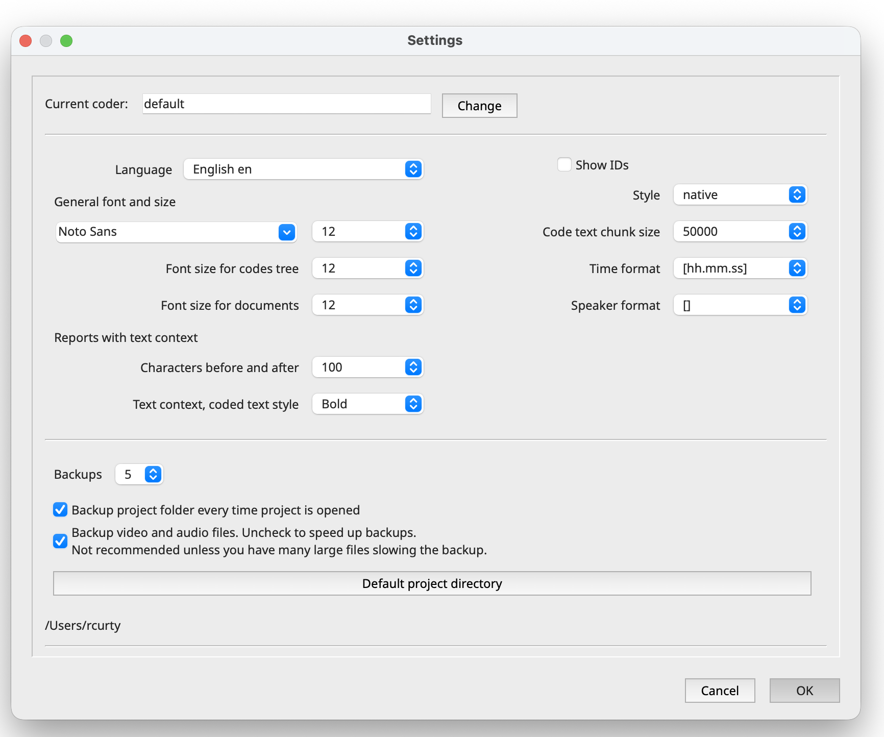
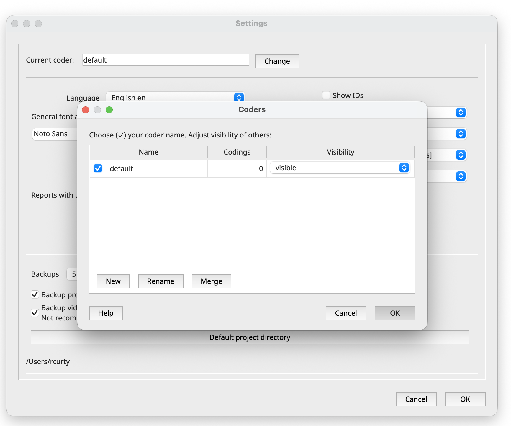
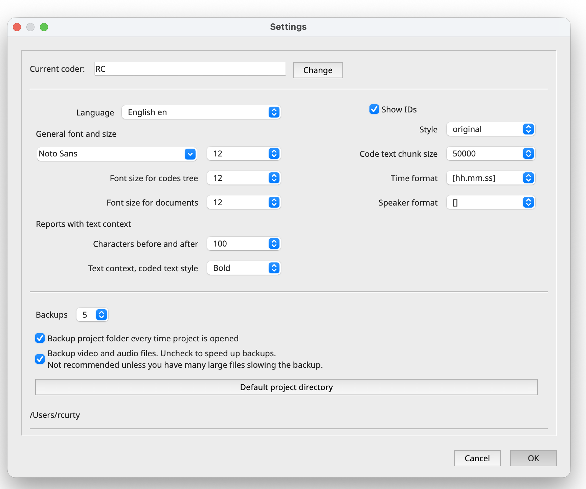

## What is QualCoder?

QualCoder is a free, open-source desktop program for qualitative data analysis. It helps you organize non-numeric data, such as interviews, documents and images, and tag meaningful passages with codes.

**What you can do with it:**

-   **Code many kinds of data:** text, PDFs, images, audio and video.
-   **Write as you think:** keep journals and attach memos to codes, files and coded passages.
-   **Organize ideas:** group codes into categories in a tree, like folders.
-   **Analyse and report:** retrieve everything tagged with a code, compare codes, and export reports.
-   **Use optional AI tools:** search for themes and discuss your data with a large language model. These are switched off by default.

**Applications**

QualCoder can be used to analyze a wide range of qualitative data files and combine them within the same research project. For example, students can **import PDF files** such as journal articles, policy documents, reports, or case studies and code them to identify key themes and concepts; **audio recordings** of interviews or focus groups can be transcribed and coded to explore participants’ experiences, opinions, and perceptions; **text files** such as open-ended survey responses, interview transcripts, field notes, or meeting notes can be organized into categories and themes; **web-based or social-media text** can be analyzed to compare public perspectives and discussions; and **images or other visual materials** such as photographs, screenshots, or field observations can be coded alongside textual data. These different file types can also be **combined and compared**, allowing students to examine, for example, whether themes identified in policy documents are also reflected in interviews, survey responses, or public discussions.

::: {.callout-note icon="false"}
## Round-Robin

*How do you envision using QualCoder in your research or coursework? What types of documents or artifacts would you analyze (e.g., journal articles, policy documents, interview recordings, transcripts, survey responses, or images)?*
:::

**Good to know:**

-   It runs on Windows, macOS and Linux, and works offline.
-   It is designed for **one person at a time**. Teams take turns on a project or merge copies later (see [Working in a team](ref-teamwork.qmd)).
-   It aims to follow the **REFI-QDA** exchange standard, so projects can move to and from tools such as NVivo, ATLAS.ti and MAXQDA, with some limits.
-   It is licensed under the LGPL v3. If you use it in coursework or research, cite it (the citation is on the QualCoder website).

The simplest route to install the software is to follow the instructions on the [setup page](index.qmd#setup) . For updated instructions from QualCoder themselves, download the ready-made installer from the [releases page](https://github.com/ccbogel/QualCoder/releases). Choose the one appropriate for your laptop.

| System | What to download | What to expect on first launch |
|------------------------|------------------------|------------------------|
| Windows | The Windows installer (.exe) | A SmartScreen warning, because the app is not signed. Click **More info**, then **Run anyway**. |
| macOS | The .dmg file | A Gatekeeper warning. Allow the app under **System Settings \> Privacy & Security**. |
| Linux (Debian/Ubuntu) | The Linux executable, or run from source | Usually no warning. |

**Optional extras (which won't be covered during this workshop)**

-   **VLC** media player is needed to code audio and video
-   **ffmpeg** lets QualCoder draw audio waveforms.

## Launching Qualcoder

After installation is completed, to open QualCoder:

-   **macOS:** Open **QualCoder** from your Applications folder or use Spotlight Search (⌘ + Space) to find and launch it.

-   **Windows:** Double-click the **QualCoder** shortcut on your desktop or search for *QualCoder* in the Start Menu.

**FIXME(CALLOUT) Important:** Windows users may see a shell/terminal window pop up, which upon closing, will also stop the running process (for example, the server or the app’s background service) and quit QualCoder. Leave this window open, or minimize it, for as long as you’re using the tool. If you close it by mistake, relaunch the application to start it again.

## Basic Preferences/Settings

We’ll start by adjusting a few settings. Open the main menu and choose **QualCoder \> Preferences** (Mac) or **Project \> Settings** (Windows).

{fig-alt="Settings and preferences in QualCoder"}

Only a few settings matter for now:

1.  **Coder name:** Every code you apply is stamped with your coder name. Set your own name (or initials) before you start, using the **Change** button. This matters later if you compare coding with a collaborator. For this, choose `change` and `rename` the system default.

    {fig-alt="Window to change the name of the coder and add new coders in QualCoder"}

2.  **Show IDs:** It is a good practice to check this option so that you will see the unique ID for each file, code, cases and other project components.

3.  **Language:** English is the default. French, German and Spanish are kept up to date; other languages are contributed by volunteers.

4.  **Font and display:** Increase the font size if text is hard to read on a projector or small screen.

5.  **Backups:** QualCoder can back up your project every hour and keep the most recent copies, named like *projectname_BKP_yyyymmdd_hh.qda*. Let's leave this on!

Applying these changes, your settings and preferences should look like:

{fig-alt="Screenshot showing the changed settings and preferences in QualCoder"}

As you may notice, QualCoder offers several additional settings, including options for integrating AI into your project. Don't worry about these for now—we'll explore them later in the workshop.

::: {.callout-note icon="false"}
## Activity 1.1 – Adding you as a Coder

Enter your name or initials so QualCoder can identify who is coding the data. Then, add a second coder (you may add any name), but keep you as the current coder. We will see how that works in practice in future episodes.
:::

::: callout-tip
## Pro-tip: Resetting preferences or coders from past projects

If you already use QualCoder and want to start from a blank slate, you can clear the settings, recent projects and saved coder name left over from earlier work. Your existing projects won’t be affected. QualCoder keeps these preferences in a hidden folder called .qualcoder in your home directory. Your projects are stored separately as .qda folders, so resetting preferences doesn’t touch them.

To reset your preferences:

1.  Quit QualCoder

2.  Rename the preferences folder

    -   macOS / Linux (Terminal): `mv ~/.qualcoder ~/.qualcoder_backup`

    -   Windows (PowerShell): `Rename-Item "$HOME\.qualcoder" ".qualcoder_backup"`

3.  Reopen QualCoder. It will start fresh, with no recent projects and no saved coder name.

Tip: Renaming the folder instead of deleting it keeps a backup. To undo the reset, rename `.qualcoder_backup` back to `.qualcoder`. Coder names are saved inside each project’s .qda file, so a new project starts with no coders from earlier projects.
:::
