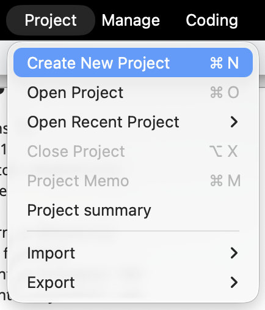
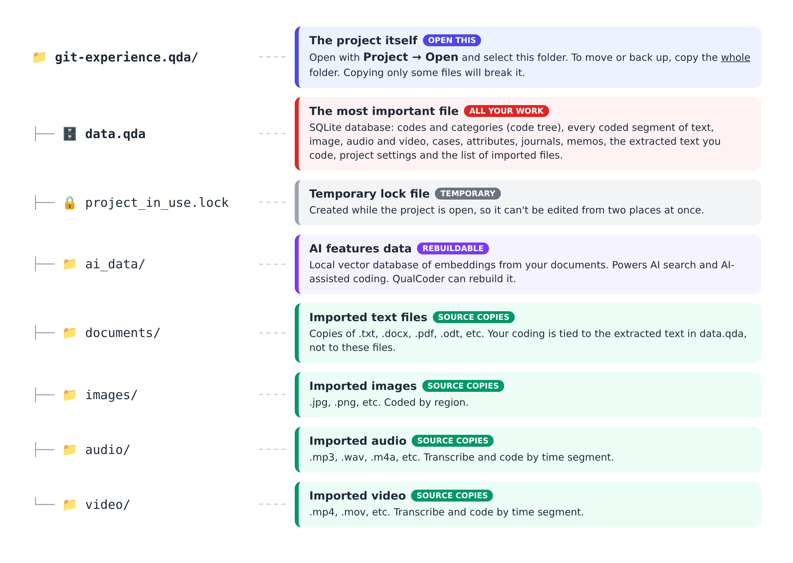
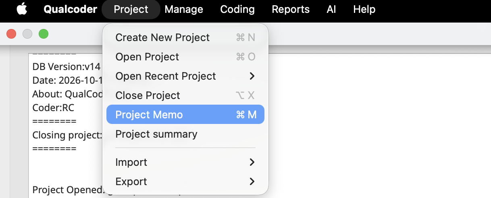
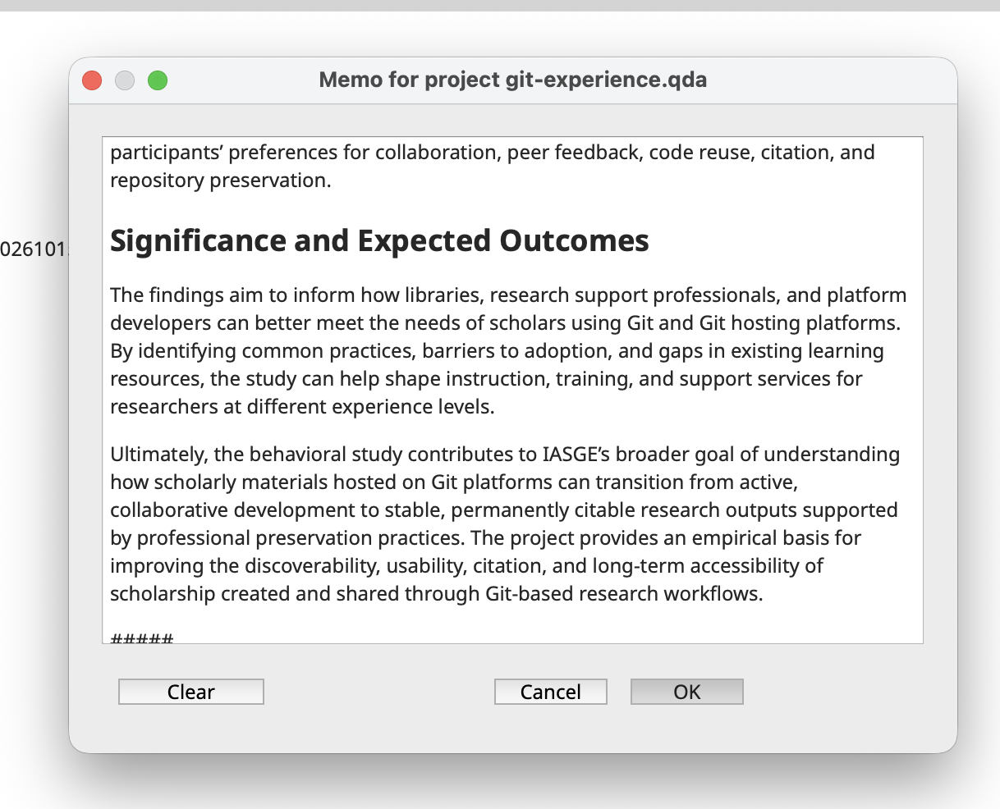
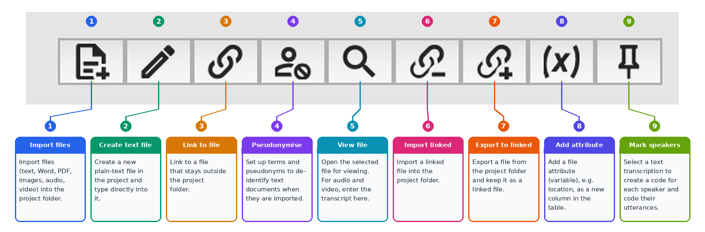
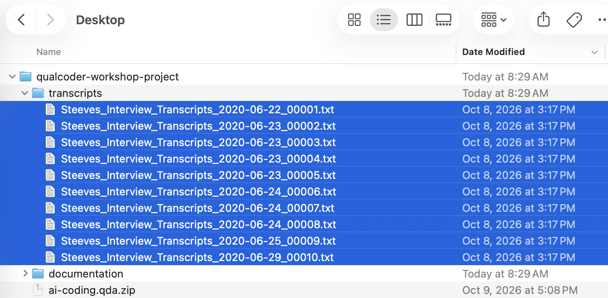
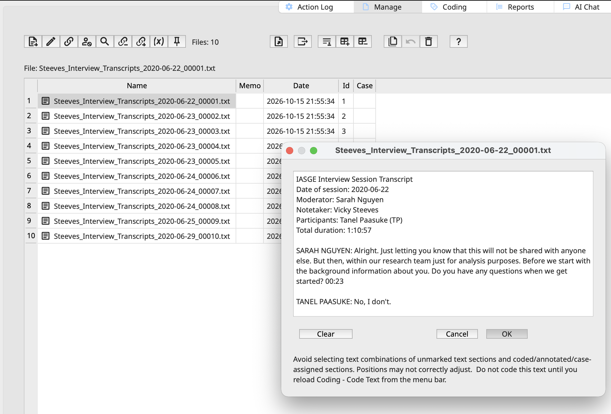
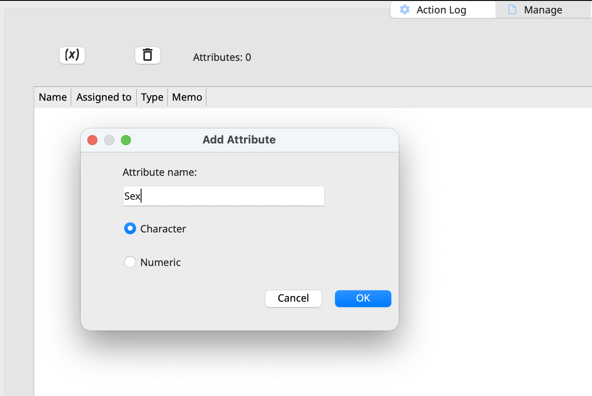
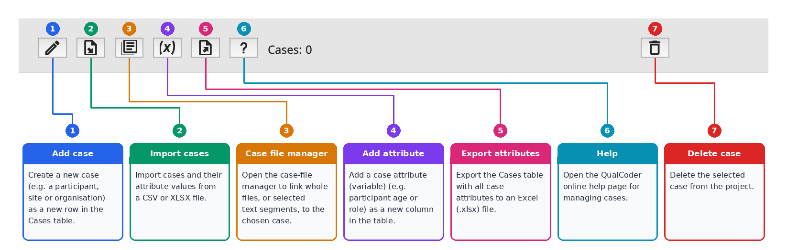
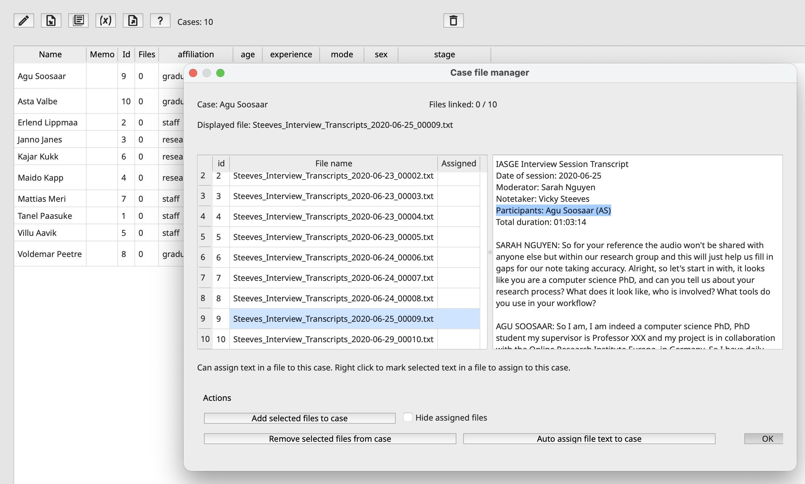

## Creating a New Project

On the main window, before exploring QualCoder and its features, let's create a new project. For this workshop, let's save the project in a folder called "Workshop" your Desktop so it's easy to locate and access. Choose **Project \> Create New Project**.

{fig-alt="Screenshot of QualCoder to create a new project" width="302"}

Next, let’s name the project **`git-experience`**. Note that this will create a folder named `git-experience.qda` inside your selected folder. Open it, and you’ll see a set of predefined subfolders:

{fig-alt="Screenshot of the file explorer, showing the top level .qda folder for the project itself, the .qda file with the database, and other folders for imported data." width="604"}

This is a **QualCoder project folder**. QualCoder saves each project as an ordinary folder whose name ends in `.qda`. Here’s what each item in it does:

{fig-alt="Diagram of a QualCoder project folder, git-experience.qda, and what each item in it does: data.qda (database holding all your analysis work), project_in_use.lock (temporary file), ai_data (rebuildable data for AI features), and documents, images, audio and video (copies of imported files)."}

## Navigating Basic Functions

The main screen has five tabs: Project, Manage, Coding, Reports, AI and Help. But since our project is empty there isn't much to explore yet.

### Adding a Project Memo

The first step will be to add a **project memo**. Adding a short memo (about 300–700 characters) describing your research question and data is good practice for future reference and clarity about the project goals and methodology.

{fig-alt="QualCoder screenshot of the options inside the Project menu"}

Let's copy the content from the `project-memo.rtf` file located in the `documentation` subfolder of the workshop folder and paste it:

> **Project Memo: Investigating & Archiving the Scholarly Git Experience (IASGE) - Behavioral Study**
>
> This project contains the data underlying the behavioral study of *Investigating & Archiving the Scholarly Git Experience (IASGE)*. The study investigates how scholars use Git and Git hosting platforms (GHPs), such as GitHub and GitLab, to conduct research, manage scholarly materials, and collaborate with others. It explores how researchers with varying levels of experience adopt version control in their workflows, what challenges they encounter, how they learn to use these tools, and how libraries and other scholarly support organizations can better support the sustainable management and preservation of research outputs.
>
> **Research Questions and Objectives**
>
> The study seeks to understand how scholars incorporate Git and Git hosting platforms into individual and collaborative research practices. It considers both scholars who actively use Git in their academic work and those who are familiar with Git but have not fully adopted it into a standardized workflow. The research examines how these groups use platform features, learn version control practices, and navigate the technical and social aspects of collaborative research.
>
> Key research questions include:
>
> -   How do scholars with different levels of experience use Git and Git hosting platforms in their research workflows?
>
> -   How do researchers learn Git, find instructions, and develop practices for managing files, tracking changes, and synchronizing collaborative work?
>
> -   How do scholars resolve merge conflicts, reuse and adapt existing code, and communicate with collaborators or external researchers through issues, discussions, and other platform features?
>
> -   How do researchers discover, evaluate, reuse, and cite code hosted in public repositories?
>
> -   What challenges do scholars encounter when using Git hosting platforms for academic collaboration, and what features or improvements would better support their needs?
>
> -   How can libraries and other scholarly support services help researchers make their code, data, and other research outputs citable, stable, accessible, and suitable for long-term preservation?
>
> **Research Design and Methods**
>
> The behavioral study uses a three-part, mixed-methods empirical approach consisting of focus groups, a survey, and semi-structured interviews. These methods provide complementary perspectives on scholarly users’ experiences, practices, preferences, and needs.
>
> Focus groups gather perspectives on Git adoption, research collaboration, common challenges, and opportunities for improving scholarly workflows. The survey collects information about users’ backgrounds, experience levels, platform use, feature adoption, and research practices. Semi-structured interviews provide a more detailed examination of individual experiences through open-ended questions and task-based scenarios. Together, these methods support an understanding of both broader usage patterns and the reasoning behind specific user behaviors.
>
> During interviews, participants discuss their research processes and demonstrate how they approach representative Git and Git hosting platform tasks. Scenarios include editing multiple files, comparing versions of a document, synchronizing local and remote repositories, resolving conflicts, forking repositories, and collaborating with other researchers. Additional tasks explore how participants communicate feedback about code, submit or respond to issues, search for reusable code, obtain citations for repositories, and arrange for persistent identifiers and long-term preservation of research materials. Participants are also asked how they learned each task, where they seek instructions, and how they would teach the same practices to others.
>
> **Data and Scope**
>
> The project data include, but are not limited to, information about participant experiences and practices, user profiles, levels of Git experience, frequency of feature use, collaboration patterns, learning strategies, and perceptions of platform functionality. Data generated through the study’s research methods provide insight into how scholars engage with version control and Git hosting platforms across different stages of adoption.
>
> The interview component also captures participants’ approaches to specific tasks, their decision-making processes, the resources they consult, and the difficulties they encounter. These observations help distinguish between knowing that a feature exists and being able to use it effectively in a research context. The study further considers participants’ preferences for collaboration, peer feedback, code reuse, citation, and repository preservation.
>
> **Significance and Expected Outcomes**
>
> The findings aim to inform how libraries, research support professionals, and platform developers can better meet the needs of scholars using Git and Git hosting platforms. By identifying common practices, barriers to adoption, and gaps in existing learning resources, the study can help shape instruction, training, and support services for researchers at different experience levels.
>
> Ultimately, the behavioral study contributes to IASGE’s broader goal of understanding how scholarly materials hosted on Git platforms can transition from active, collaborative development to stable, permanently citable research outputs supported by professional preservation practices. The project provides an empirical basis for improving the discoverability, usability, citation, and long-term accessibility of scholarship created and shared through Git-based research workflows.

{fig-alt="Screenshot of the project memo window" width="487"}

**Project memos** can also provide context for AI tools integrated into QualCoder, helping them generate more relevant, consistent, and contextually informed suggestions and analyses. Any text written after a line containing `#####` remains private and is not shared with the AI model. In the example below, however, we will keep the entire memo visible to the AI to demonstrate how project-level context can inform its responses later in the workshop.

## Managing/Importing Files

With the project memo in place, let’s bring in the data we’ll be working with by importing the interview files we’ll code and analyze.

All data in QualCoder comes in through **Manage \> Files**.

| Type            | Accepted Formats                                    |
|-----------------|-----------------------------------------------------|
| Text            | .txt, .docx, .epub, .md, .odt, .pdf, .rtf, .tex     |
| Images          | .jpg, .jpeg, .png                                   |
| Audio and video | .mp3, .m4a, .wav, .mp4, .mov, .ogg (and .wmv video) |

Take a moment to familiarize yourself with the menu. We won't explore every function, but since some QualCoder icons may not be immediately intuitive to new users, you can hover over each icon to see a tooltip describing its functionality.

{fig-alt="QualCoder Manage Files toolbar with nine numbered buttons and what each one does: Import files, Create text file, Link to file, Pseudonymise, View file, Import linked, Export to linked, Add attribute and Mark speakers." width="546"}

Click the first icon (the document with a plus sign) to import files.

A window should open, allowing you to browse for and select the files you downloaded for this workshop. We will be uploading 10 interview transcripts that use aliases instead of participants’ real names to protect their identities.

{fig-alt="Screenshot of selected transcripts for import" width="557"}

\
The files should be displayed in our window, and double-clicking a file should open and display its contents.

{fig-alt="Screenshot showing the imported files and a window with the contents of one of them"}

::: callout-important
## Prepare Data Before Importing into QualCoder

QualCoder *should not* be used to edit, de-identify, or pseudonymize raw data. Although pseudonymization is a newly released feature, it is not yet sufficiently robust for routine use. Best practice is to import only finalized, analysis-ready transcripts and notes into the platform for coding.
:::

The **memo** field can be used to record any notes or annotations relevant to the file, including its relationship to other files or data sources.

More generally, the memo can capture contextual information, methodological notes, or other details that help document the file and support subsequent analysis. We won't be using file memos in this workshop, but you may find them useful in your own projects for documenting additional information about your data and keeping track of details that may be relevant during analysis.

Note that that the time and date stamp reflect the import, not the file creation. IDs are sequentially assigned and depends on how you have selected the imported files. But what are **cases** for?

### Cases

**Cases** allow you to group data around a person, place, organization, or situation. In QualCoder, a case provides a way to bring together files and descriptive information associated with the same entity, making it easier to organize and compare data during analysis. You can also assign **attributes** to cases, such as a participant's age group, gender, occupation, or other characteristics relevant to your research.

*Do you need cases?* Not always! If each participant has only one interview file, you can assign attributes directly to the file, without creating a separate case for each participant.

Cases become more useful when your data are more complex. For example, you might collect not only multiple interviews with the same participant but also observation notes, field notes, documents, photographs, or other relevant materials. You can use a single case to group all these files and associate them with the same participant attributes. This allows you to examine the participant’s experiences across different data sources, compare what they said in interviews with what you observed or documented, and develop a more comprehensive understanding of their perspectives without treating each file as a separate case.

Cases can also be useful when a single file contains data from multiple participants, as in a focus group transcript. You can create a separate case for each participant and associate relevant segments of the transcript with the appropriate cases. This helps you distinguish participants' contributions and compare their perspectives, even though their statements appear in the same file. Understanding how they work will be helpful as you begin working with larger or more complex datasets in your own projects.

For this workshop, even though we only have one file per case, we will proceed creating cases, but using a more streamlined approach combining it with attributes.

### Attributes

QualCoder also allows you to manage attributes by selecting **Manage \> Attributes**.

File attributes describe a particular file, whereas case attributes describe the entity represented by the data. For example, an interview's date and mode of collection are file-level characteristics, while the participant's age group and occupation are typically case-level characteristics. The choice depends on your research design and what you want to compare during analysis.

**File attributes** describe individual files. For example, you could record the interview date, interview mode (in-person, telephone, or online), or participant's age group and occupation for an interview transcript. These attributes are useful when you want to compare files based on their characteristics.

**Case attributes** describe the people, places, organizations, or situations represented in your data. For example, if you create a case for each participant, you could assign attributes such as age group, occupation, education level, or region. If a participant has several interview files, these attributes belong to the case rather than needing to be repeated for every file. You can then use the attributes to compare participants or explore patterns across groups.

::: callout-note
#### The Role of Attributes in Analysis

Attributes will allow you to ask questions like "Do first-year students talk about stress differently from final-year students?". It allows you to query and explore the data considering demographics and other important characteristics associated with the documents you are analyzing.

Please remember that QualCoder is designed primarily for qualitative data analysis, supporting the systematic coding, organization, comparison, and interpretation of qualitative data. Although attributes can help you describe participants, cases, and other data sources, the main purpose is to support qualitative inquiry rather than statistical analysis. For statistical analysis of attributes, you can export your data to a suitable quantitative analysis tool, such as R.
:::

Attributes can be added manually by clicking on the variable symbol, the (*x*) button, shown below:

{fig-alt="Screenshot showing the Manage Attributes window while adding an attribute" width="483"}

However, there is an **easier way to import them from a survey**. QualCoder allows researchers to import `.csv` or `.xlsx` files with the description of cases and their associated attributes, and we have prepared it for you.

Select **Manage \> Cases**, then click the second icon from the left, which depicts a page with a downward-pointing arrow, to import the file. Choose `cases-attributes.xlsx` from the workshop folder. The imported data should then appear as shown below. Take a second to also hoover over other icons.

{fig-alt="QualCoder Manage Cases toolbar with seven numbered buttons and what each one does: Add case, Import cases, Case file manager, Add attribute, Export attributes, Help and Delete case. The case counter reads “Cases: 0”."}

The fourth icon/function will be particularly useful for the next activity.

::: {.callout icon="false"}
#### Activity 2.1 - Adding Attributes Manually

Add a **mode** attribute to indicate whether each interview was conducted online or in person. Set the mode to **online** for the first 5 files and **in-person** for the other 5.
:::

::: {.callout icon="false"}
#### Using Attributes for Insight

Identify one attribute or combination of attributes that could help uncover a meaningful insight in our data. What would you look for, and why?
:::

If everything looks good, click **OK**. Now, let's go to **Manage \> Cases**. Note that the column files shows 0. Why? Because we have yet to link files to cases. Double-click the **0** value to prompt the case file manager window.

Now, we will assign files to cases. Select the corresponding file to match case (participant). We can assign by clicking on the file and choosing **Add selected files to case**.

{fig-alt="Screenshot of successful linkage of files to their specific cases."}

Before confirming, verify that the name matches the participant listed in the transcript header. Note that the file assignment now displays **YES**. Once you click **OK**, the grid will update to show 1 file associated with Au Soosaar.

You can also undo assignments or bulk-assign multiple documents within a selected range, though that won't be relevant in this case. You might also check **Hide Assigned Files** to reduce the list and avoid confusion.

**Auto Assign File Text to Case** streamlines assignments by defining rules based on file names, automatically assigning files to the appropriate cases. This feature is most useful when multiple files are associated with the same case.

::: {.callout icon="false"}
#### Activity 2.2 - Connecting Cases & Files

Complete the assignments for the remaining nine cases/files, ensuring that each file is assigned to the correct case based on the interviewee’s name.

Take a moment to reflect which strategy with file naming could have made this assignment process easier.
:::

With our files, cases, and attributes all set up and connected, it’s time to dive into QualCoder’s main feature. Any guesses what comes next? Coding, of course!
