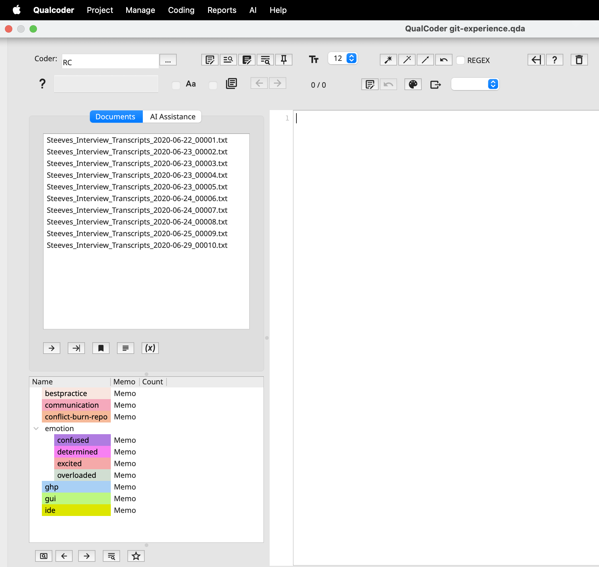
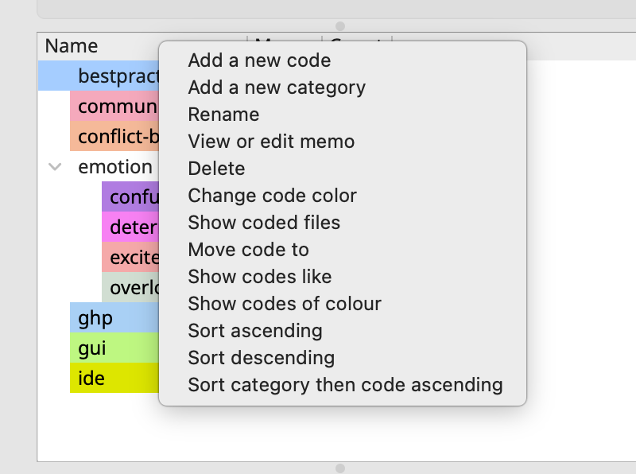
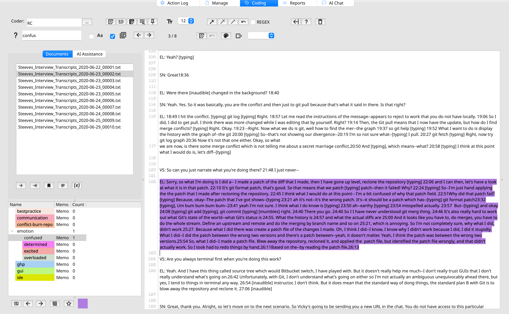

## QualCoder Coding

As covered before, coding means attaching a short label (a **code**) to a passage of data that expresses an idea relevant to your research question. Codes are then grouped into **categories**, which can grow into themes.

| Term | Meaning | Example |
|------------------------|------------------------|------------------------|
| Code | A label applied to a passage | *Sleep loss* |
| Category | A group of related codes | *Physical effects of stress* |
| Coded segment | The passage a code is attached to | "I barely slept the week before finals." |
| In vivo code | A code named with the participant's own words | *"running on empty"* |
| Memo | A note explaining your thinking about a code or passage | "Several students link sleep to caffeine use." |

Codes can be planned in advance from theory (**deductive**) or emerge as you read (**inductive**), but often projects mix both.

## Codebook

As we start assigning codes to excerpts we start developing what it is called a codebook. In qualitative research, a codebook is the shared framework that turns raw text into analyzable data. Each entry typically names a code, gives a concise definition (memo), and sets inclusion and exclusion criteria for when the code applies and when it doesn’t.

Similarly to codes, codebooks can be built deductively from theory or prior literature, inductively from patterns that emerge during close reading, or through a mix of both. Often it changes over several rounds as the team refines, merges, splits, or retires codes. That evolution is itself part of the analytic record, so keeping versions and logging changes helps document how interpretations developed. When several researchers code the same material, the codebook keeps them aligned. It makes intercoder agreement possible to assess, and it gives the team a concrete reference for talking through disagreements instead of relying on each person’s intuition.

Beyond the life of a single project, a well-documented codebook makes qualitative work more transparent and credible. Readers and reviewers can see how claims were grounded in the data, and other researchers can understand, critique, or adapt the analytic approach. It also makes archived qualitative data far more usable for secondary analysis, since the meaning behind each code stays clear long after the original team has moved on.

## Importing a Codebook

To get started, we’ve prepared a sample codebook. Starting from a set of predefined codes is typical of a **deductive** approach. Later, we’ll also try an **inductive** approach, where we create new codes for themes that come up as we read the transcripts.

You can export a codebook from QualCoder and share it as a `.qdc` file, which we’ll do near the end of the workshop. If you’re starting a project from scratch, you can also import a list of codes from a plain-text file, and each code can include a description (memo).

In the project example folder, find the file `Steeves_Interview_Codebook.csv` and open it in a text editor or spreadsheet program. Here’s how it’s structured:

{width="731"}

The first column contains the code names, and the second contains each code’s description, which QualCoder imports as the code’s memo. Notice the double angle brackets (`>>`) in some code names. They show how a code relates to a higher-level category. For example, `emotion>>confused` means the code *confused* belongs under the category *emotion*.

Alright, let's now import the codebook by following **Project \> Import \> Import plain text codes list**.

{width="676"}

Great! You should now see your list of codes in the lower-right panel. Each code has been given a color automatically. You can change these colors under **Code \> Color Scheme**. Colors give you quick visual cues, and giving related codes similar shades makes them easier to spot together. For now, we’ll leave the default colors as they are.

{width="736"}

Clicking **Memo** opens a separate window with the code’s description, or definition. Expect to revise these descriptions as your analysis develops. As you code more transcripts, you’ll find edge cases and clarify where one code ends and another begins.

## Building & Organizing the Code Tree

Codebooks are represented hierarchically as a tree: categories act like folders, codes sit inside them, and can also have sub-codes. A code can belong to only one category. If an idea fits two places, we recommend creating two similarly named codes.

While we will stick to this structure for this workshop, you can rearrange things, through right-clicking for options to move, merge, delete, sort and more.

{width="465"}

For a bigger clean-up, open the **Code Organizer** under **Coding**. It shows your codes and categories as a diagram you can restructure: move, merge, rename and remove codes and categories, add new categories, and export the view as a PNG.

With files and our code tree in place, let's get started with practicing some coding.

## Coding text step by step

Open **Coding \> Code text**. The code tree sits on the left, your document in the center, and the file list nearby.

We will start by examining File 02. Since we won't have time to examinethe entire file, let’s scroll down and jumpt to line 120. Great! We can now see the excerpt where the interviewer asks, “VS: So can you just narrate what you're doing there?”

Although we don’t need to read every detail, we can see that the interviewee is describing a process while expressing uncertainty, frustration, and confusion.

Select the paragraph at line 122. Our codebook already includes the code **Emotion \> Confused**, so we can apply it to this excerpt by clicking the code. The selected passage takes on the code's color, and a number appears next to the code showing how many times it has been applied. That count also adds to the total for its parent category, **Emotion**. The parent’s number is the total for all of its sub-codes. This lets you see how often a broad theme comes up, as well as each specific variation of it.

If you select a text segment by mistake or need to undo the coding, you can right-click the selection and select Unmark (U). Shortcuts after highlighting: **Q** reuses your most recent code, **R** lists recent codes, and **V** makes an *in vivo* code from the selected words.

Before you start, look at the code list. The number next to **confused** is gone, but **emotion** still shows **1**. The code list only shows counts for the file that’s currently open, so **confused** has no count in file 07. **Emotion** still shows **1** because the code you applied in the previous file still counts toward it.

Your work hasn’t been lost. Everything you coded in the previous file is saved. In a later episode, we’ll look at reports that show code counts across all files.

Going back to **file 07** let's look for **line 71,** where the interviewee starts describing their approach to editing multiple files in the repository. Skim through the passage, for this exercise we will consider it expresses confidence in the workflow, and code it as **determined**.

### Coding with Search Assistance

See the question mark on the left-hand side of the top bar? That allows us to search for words across files, and can be useful to identify relevant terms before we apply codes. Let's look for GUI, which stands for Graphic User Interface, and apply the GUI code the excerpts with the first 5 results (in order of appearance). Select "Aa" to make the search case sensitive, and navigate matches across files using the arrows.

### **Where should a selection begin and end?**

Deciding how much text to select is one of the main choices you make when coding. A few guidelines:

-   **Select a complete thought.** Start where the participant begins the idea and stop when they finish it or move on to a new topic. That might be a phrase, a sentence or a whole paragraph.

-   **Include enough context to understand it later.** Someone reading the excerpt by itself, for example in a report, should still be able to tell why it was coded. If “It was a nightmare” only makes sense with the sentence before it, select both sentences.

-   **Leave out what doesn’t belong.** Don’t add filler, the interviewer’s next question or a new topic just to fill out the excerpt. Extra text makes reports harder to read and blurs what the code means.

-   **Overlapping is fine.** A passage can have more than one code, and selections for different codes can overlap. For example, one sentence might be coded **Confused** while the whole paragraph is coded **GUI**.

-   **Be consistent.** Use the same approach across all transcripts, especially if you’re coding with other people. Some teams agree on a default unit, such as “the full answer to one question,” before they start.

### In Vivo Coding

As most QDAS, QualCoder also offers the option for researchers to apply InVivo coding. **In vivo coding** means using the participant’s own words as the name of a code. Instead of making up a label such as **Frustration**, you take a short phrase straight from the transcript, such as **“I just nuked the whole repo.”** *In vivo* is Latin for “in the living,” meaning the code comes from the data itself.

In vivo coding is an **inductive** approach because the codes come from the transcripts, not from a predefined codebook. It’s useful when you want to:

-   keep participants’ voices and terms in your analysis

-   capture slang, jargon or vivid expressions that a generic label would lose

-   start exploring data before you have a clear set of themes

In vivo codes are often renamed or grouped into broader categories later. For example, **“I just nuked the whole repo”** might end up under the existing code **conflict-burn-repo**. Let's select File **04** and look for **line 131**, where the interviewer mentions The Carpentries, and let's apply an in vivo code to that, using the right-click or the shortcut (Command or Ctrl + V).

### Add your Reasoning

Codes show *what* you noticed. Memos and annotations record *why*. Writing down your reasoning as you go makes your analysis easier to explain, review and share with others.

Besides code memos, QualCoder lets you add notes to the text itself:

-   **Coded excerpt memo:** A note attached to one coded excerpt. Use it to explain why you applied that code to that text, or to flag a borderline case. For example: *“Coded as Confused, but this could also be Overloaded. Revisit.”*

-   **Annotation:** A note attached to a piece of text, whether or not it’s coded. Use it for first impressions, questions or links to other parts of the data. For example: *“Compare with the participant’s answer in file 03.”*

To add either one, right-click the text and choose the option from the menu.

These notes become a record of how your thinking developed. They’re especially useful when you refine codes, merge or split them, or code with other people.

-   **Memo** a coded segment: hover over it and press **M**. Memoed text appears in italics.
-   **Annotate** any selected text, coded or not, by pressing **A**. Annotated text turns bold.
-   Flag a strong example as **Important** with **I**. The star button under the code tree then shows only important segments, which is handy for picking quotes.

### Auto-coding (use with care!)

**Auto-code** in QualCoder applies a code to every passage that matches text you specify, so you don’t have to select each passage by hand. You’ll find the options as buttons at the top right of the text-coding window. First select the code you want to apply, then choose an option:

-   **Auto-code exact text** codes every occurrence of a word or phrase. QualCoder asks which files to search, so you can code across several transcripts at once. Separate alternatives with `|` to catch several terms with one code, for example `GitHub Desktop|GUI`. Matching is **case-sensitive**.

-   **Auto-code sentences** codes the whole sentence that contains a text fragment, not just the fragment. You can set what counts as the end of a sentence. The default is a period followed by a space.

-   **Auto-code between start and end marks** codes everything between a start text and an end text in the current file. It’s useful for structured transcripts, such as coding everything from one interview question to the next.

-   **Regex** is a checkbox that lets you use regular expressions for more flexible matching, such as wildcards and word variations.

-   **First or last match only (version 3.8 and later)** is a right-click option that codes only the first or last match in each file.

-   **Mark speakers** codes each paragraph with the speaker’s name when transcripts label speakers as `[name]`, `{name}` or `name:`.

-   **Undo** reverses recent auto-coding, but only until you close the project.

For the workshop, keep in mind that auto-coding matches words, not meaning. Searching for “confused” won’t catch “I had no idea what was going on,” and it will catch “I wasn’t confused at all.” Treat auto-coding as a first pass, and review every coded passage before you rely on it.

Buttons at the top right can code every exact match of a word (case-sensitive; separate options with `|`, e.g. `exam|exams`), every sentence containing a fragment, or the section between two markers. **Mark speakers** creates a code for each speaker in a transcript.

::: callout-warning
Auto-coding can be undone only until you close the project, so always review the results and proceed with care.
:::

::: {.callout-tip icon="false"}
## Activity 3.1
:::

::: {.callout-tip icon="false"}
## Activity 3.2
:::
