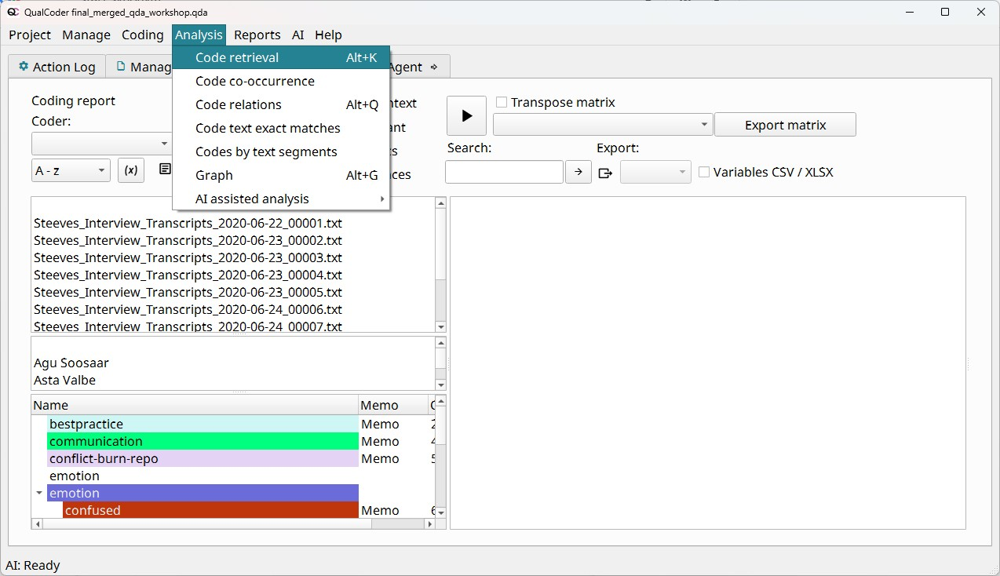
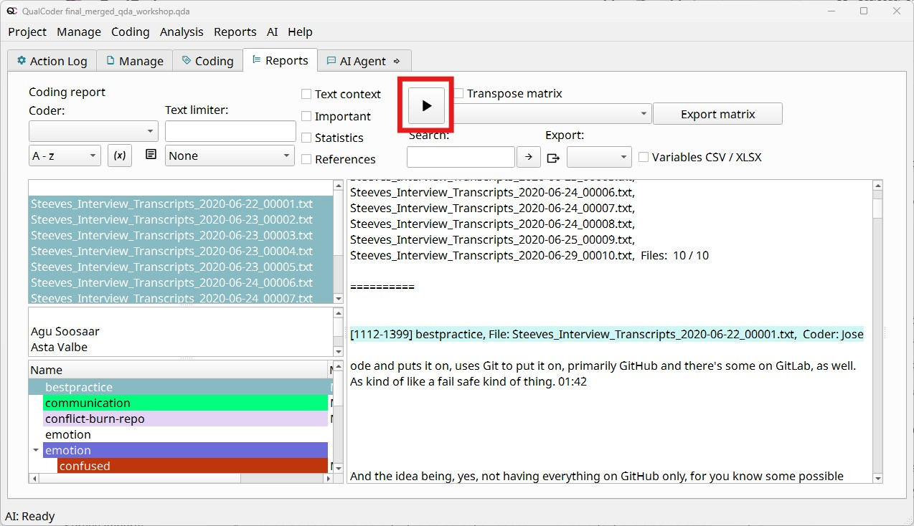
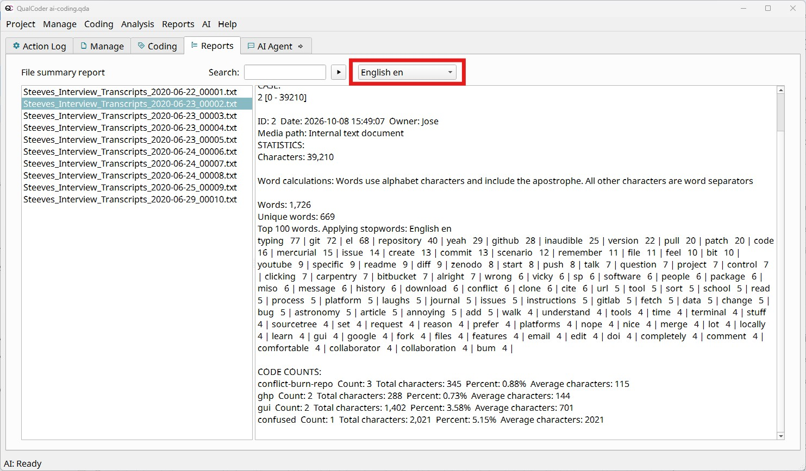
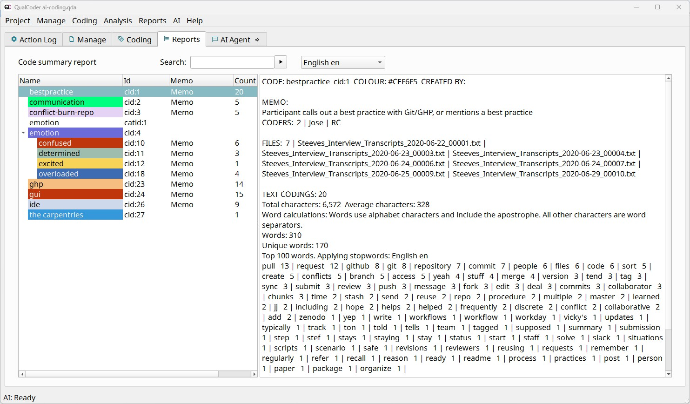
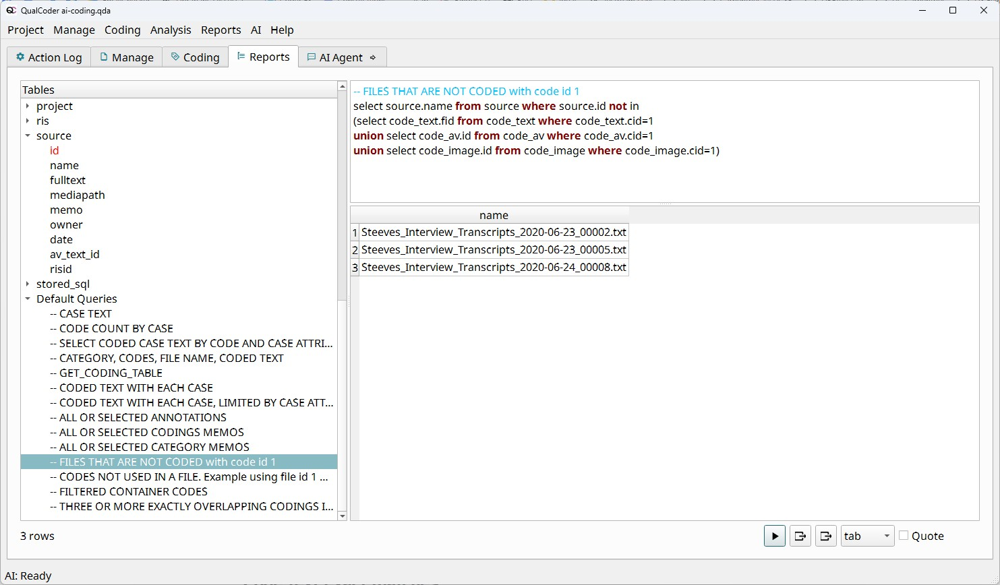

Beyond letting you code  data, QualCoder provides powerful tools to analyze your results and create reports and graphs. If you want to report an issue in QualCoder or request an additional feature, please open a `New issue` on the [GitHub repository for the project](https://github.com/ccbogel/QualCoder/issues).

We'll dive into five of the most frequently used tools, but bear in mind that there is much more to explore:

- **Code retrieval:** A list of all coded text, or a subset of it based on the chosen filters.
- **Code co-occurrence:** A matrix counting how many times two codes appear in the same text.
- **Charts:** Word clouds, bar charts counting code frequency, pie charts showing relative frequency, and code heatmaps by file or case.
- **File and code summaries:** For a given file or code, show how many characters were coded and what the most frequent words in the data are, with the option to remove common words (stopwords).
- **Database queries:** Advanced users can run SQL queries on the project database. Back up first, as queries can change data.

Other tools:

- Code comparison and frequencies, in case you have multiple coders and want to run an intercoder reliability analysis.
- Journals, a place in your project to keep notes on your ideas.

::: {.callout-note}

## Before we start: Merging projects

Since we haven't coded much text yet, we will merge another project into the one we are working on now.
This will enrich the demonstration of the different analytical and reporting tools, as we will have more data show up in the outputs and plots.

Beyond this workshop, merging projects is useful when multiple coders analyze the same files and you want to bring their work together.

To merge the project we have prepared for you, follow these steps:

1. Make sure the `qualcoder-workshop-project` folder you downloaded for the workshop contains a folder called `coded-project.qda`.
2. In QualCoder, go to **Help > Special functions**.
3. In the pop-up window, click the button inside the `Merge project into this project` section.
4. Click the `Run` button.

:::

## Code retrieval

To see all the coded excerpts together and analyze your data as a whole, start with the Code retrieval tool (sometimes called the coding report), under **Analysis > Code retrieval**.

{fig-alt="Screenshot of the code retrieval window"}

Once you are there, the usual workflow is:

1. Choose one or more codes or categories.
2. Select one or more files. If you want to retrieve all coded excerpts for the given code(s), select all the files.
3. Optionally narrow by case, attribute (e.g. only second-year students), or coder.
4. Click the `Run` button (as highlighted in red in the next screenshot) to display the results in the right pane.

{fig-alt="Screenshot of the code retrieval window, selecting all files, the bestpractice code, and highlighting the run button that shows the results"}

::: callout-tip

## Tip: Selecting multiple files, codes, or cases

Whenever you want to select multiple files, codes, or cases, the fastest way to select a range is to use the `Shift` key.
For example, if you want to select all the files, you would: 1) Select the first file, File 001; 2) Press and hold the `Shift` key; 3) Select the last file, File 010; 4) Release the `Shift` key.

To select files that aren’t next to each other, hold `Ctrl` (Windows) or `Cmd` (macOS) while clicking.

:::

You can analyze your data directly on this screen, scrolling up and down in the right pane.
You can also export the results to HTML, TXT, CSV, XLSX, or ODT to read them in different software.

Another option is to use the **matrix view** to place codes (or categories) against files or cases, so you can see who talked about what. This tool is located to the right of the `Run` button we used to display the results. You can export the resulting matrix to XLSX.

## Code co-occurrence

This tool creates a matrix with all your codes along both the vertical and horizontal axes. Each cell shows how many times the two codes overlap or appear right next to each other in your data. You can open it by navigating to **Analysis > Code co-occurrence**.

{fig-alt="Screenshot of the Code co-occurrence tool, showing the options each button in the screen enables"}

Clicking on a cell shows the text where both codes have overlapped.

{fig-alt="Screenshot of the Code co-occurrence tool, showing the text details for a given combination of codes"}

This is a useful result for your analysis, mainly in two ways:

- If you notice redundant codes (being used for the same phenomenon), you migth decide to **merge them**.
- If you see two codes that tend to appear close together across multiple cases, this may point to a **relationship** between the phenomena, which could be an emerging theme.

## Charts

You can easily generate and export several types of charts based on aggregated data.

Go to **Reports > Charts** to see the available charts. For all of them you can filter what data is included in the plot with the options under "Data filters".

- **Pie**, **sunburst**, and **treemap charts** show the relative frequency (percentage) of times a code is used.
- **Bar charts** show how many times each code is used; **cumulative bar charts** break this down per file or case.
- **Heatmaps** show a visual comparison of the frequency with which a code is used by file or case.
- **Attribute charts** to describe your cases or files by the attributes you have assigned to them.
- **Word clouds** to show the most frequent words in your coded data.

::: {.callout-tip icon="false"}
## Activity: Explore the charts available

Choose one of the available charts and try it out. Then, write a brief analysis of what the chart shows.

:::

Once the plot shows up in your web browser, you can download it by clicking the camera icon in the top-right corner.

## File and code summaries

In the **Reports menu** you can find **File summary** and **Code summary**.

- File summary shows the following statistics for the file you select in the left pane:
    - Total number of characters, words, and unique words in the file.
    - Top 100 words in the file and their frequency. Use the drop-down menu shown in the screenshot below to filter out common words (also known as stopwords).
    - For each code used in the file: the number of times it was used, the number of coded characters, and a percentage of the total character count.
    
{fig-alt="Screenshot of the File summary tool, highlighting the option at the top to filter stopwords"}

- In contrast, Code summary shows:
    - Coders who used the code and files in which it appears.
    - Number of times the code has been used, along with the number of characters in the excerpts and the average per excerpt.
    - Number of words and unique words in the coded excerpts.
    - Top 100 words in the excerpts and their frequency. The option to remove stopwords is also available here.

{fig-alt="Screenshot of the Code summary tool"}

## Database queries

QualCoder gives you direct access to the database behind your project data in **Reports > Database queries**.
For users who are comfortable with SQL queries, it will be useful to get custom reports from their project.

*Remember, back up your project first, as queries can change data*.

Let's see three examples:

1. Using a default query to list files that don't include a given code

    - In the left pane, scroll all the way down to "Default Queries"
    - Select "FILES THAT ARE NOT CODED with code id 1"
    - Click the `Run` button to execute the query
    - The result shows the files that don't have the code with ID 1, which in the example represents "bestpractice"
        - You can see the query includes not only coded text (code_text), but also audio/video (code_av) and images (code_image)
        - Try modifying the query to use a different code ID, or to show the files that do have the code

{fig-alt="Screenshot of the Database query tool"}

2. Write a simple query that all file names where the full text contains the word "rstudio"

    ``` sql
    SELECT id, name
    FROM source
    WHERE fulltext LIKE '%rstudio%' OR fulltext LIKE '%r studio%'
    ```

   We could read this query as follows:
    
   - The database has a table of data called `source`, which contains all your file sources
   - This table has fields `id`, `name`, and `fulltext`, containing the file IDs, names, and full text
   - The `WHERE` clause keeps only the files whose text contains either ‘rstudio’ or ‘r studio’.

3.  A more complex query, involving the `code_name` and `code_text` tables, searching for coded text that contains the word "jupyter"

    ``` sql
    SELECT source.name, code_name.name, code_text.seltext
    FROM code_text
       JOIN source ON code_text.fid = source.id
       JOIN code_name ON code_text.cid = code_name.cid
    WHERE code_text.seltext LIKE '%jupyter%'
    ```

If you want to learn more about databases and SQL, we invite you to read the [Software Carpentry](https://swcarpentry.github.io/sql-novice-survey/) or [Library Carpentry](https://librarycarpentry.github.io/lc-sql/) lessons.

## Other tools

### Code comparison and code frequencies

If your project involves multiple coders reviewing the same data, you'll likely want to compare their coding agreement. In other words, you're interested in [intercoder reliability](https://perma.cc/C8ES-SSPH), also known as inter-rater reliability. The tool in **Reports > Comparison** compares two coders on the same text using percentage agreement and **Cohen's kappa**, a measure of agreement that accounts for the agreement expected by chance.

To see the number of coded passages, broken down by code name and coder, use **Reports > Code frequencies**

If you are interested in learning more about intercoder reliability for your project, reach out to the Library's Research Data Services department at [rds@library.ucsb.edu](mailto:rds@library.ucsb.edu).

### Journals

Journals are free-form notes for recording ideas, decisions, and emerging themes as you code. They support reflexivity: being aware of how your own views shape the analysis.

- The journal window floats, so you can keep it open beside the coding screen.
- Add simple formatting with Markdown: `#` for headings (up to three levels), `*italics*`, and `**bold**`. Use the right-click menu to make web links clickable.
- Search journals, sort them by name or date, filter them, add attributes, and export one journal or all of them as a single file.

You can see and manage all your journals under **Manage \> Journals**.

::: callout-note

**Memo vs. journal:** a memo belongs to one code, file or passage; a journal entry is about the project as a whole.

:::
