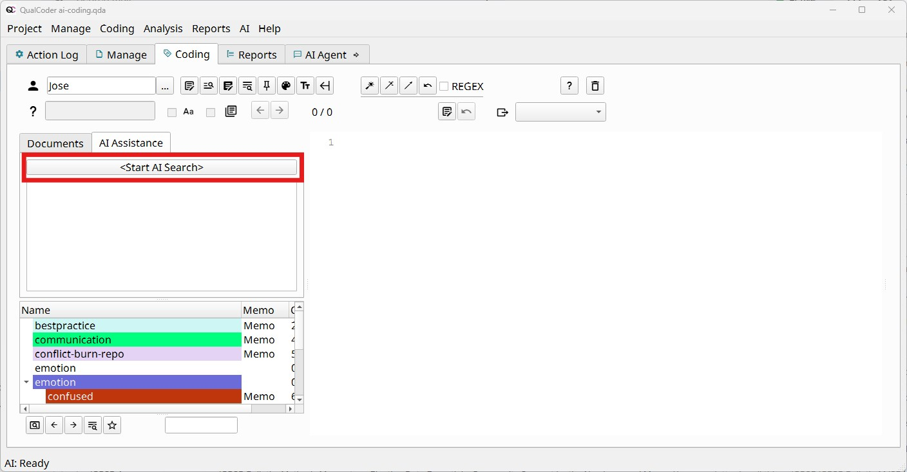
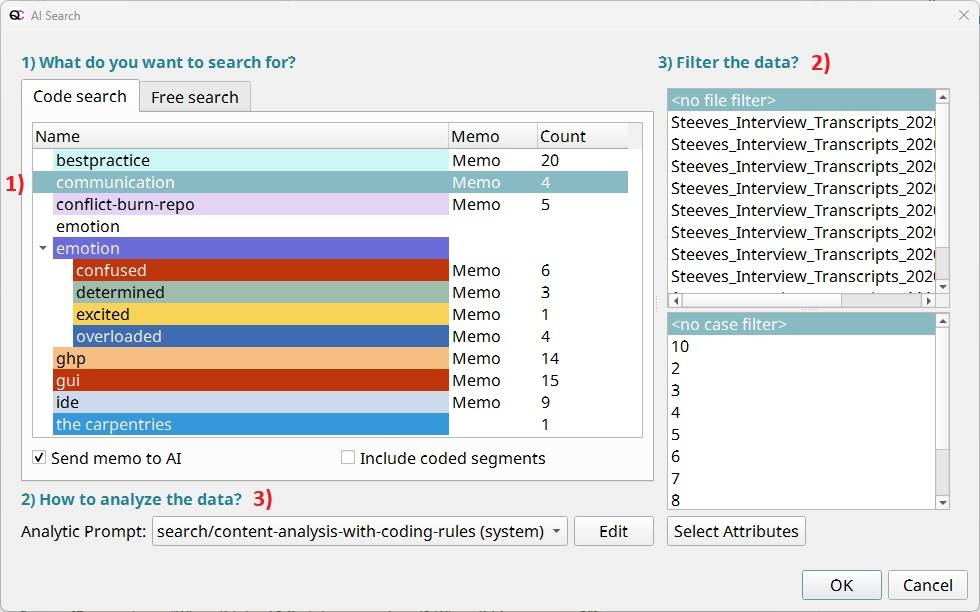
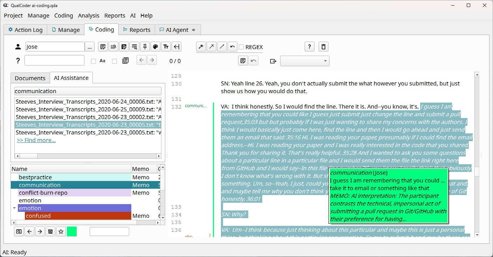

## AI in QualCoder: setup, privacy and responsible use

When launching the software for the first time, you were likely prompted to choose whether to activate QualCoder's AI features or keep them disabled. These tools are completely optional. In this final section of the workshop, we will demonstrate how to use several of these AI features. **Following along with these practical steps is entirely optional.**

::: {.callout-tip icon="false"}
## Reflection on AI

- What are your feelings regarding AI?
- Do you consider it appropriate to use AI as an assistive tool for qualitative coding?
- What are the primary advantages and disadvantages of integrating AI into your qualitative workflow?
:::

### Setting up

1.  In the top menu, navigate to `AI > Settings`).
2.  Enable "AI integration" and select a model. Options include commercial models (such as OpenAI, Anthropic, Google, and Mistral) requiring an API key, free services for researchers like Blablador, multi-model gateways like OpenRouter, local models via Ollama (which process data locally on your machine), or institutionally hosted services such as UCSB's AI Commons.
3.  For this demonstration, we will use UCSB's [AI Commons](https://app.aicommons.ucsb.edu/). You can generate an API by visiting <https://app.aicommons.ucsb.edu/account/api-keys>.
    1.  Note both the Base URL and the generated API key, as QualCoder requires both parameters.
    2.  In QualCoder, select `"Advanced AI Options..."`, then `"New AI Profile..."`. Enter a profile name of your choice (e.g. `"ai-commons"`).
4.  Paste the API key (and the API Base URL, if using a custom model)into the designated fields.
5.  Select a Large Model and a Fast Model from the drop-down menus - The Fast Model handles administrative and background tasks (such as generating titles for new chat sessions), whereas the Large Model executes data analysis tasks. - For this demo using AI Commons, select `claude-v5-sonnet` as the Large Model and `openai-gpt-oss-20b` as the Fast Model.
6.  Configure permissions for the AI model. Select `"Read-only"`, which grants the AI permission to read existing codes, memos, and attributes without allowing it to create or modify data. For additional details, consult the QualCoder documentation on [permission levels and limitations](https://qualcoder.org/doc/en/5.1.-AI-chat-based-analysis/?h=sandbox#what-are-its-limitations).
7.  Wait while QualCoder generates its local memory. This indexing process occurs only during initial setup and when new files are added, enabling rapid search and retrieval across empirical documents.

**Preparing your project:** AI tools produce more accurate results when your project includes clear project memos, descriptive code memos, standardized file names, and labeled speakers in interview transcripts.

### Privacy and Data Security

- QualCoder transmits only brief text excerpts (approximately 500 characters each) to cloud models rather than entire documents.
- Anything in a memo after a `#####` line is never sent to the AI.
- Always de-identify and anonymize sensitive data prior to using cloud services, and check what your ethics approval allows.

## Available tools

QualCoder offers AI features designed to support, rather than replace, your qualitative analysis. The AI assists by suggesting, searching, and synthesizing patterns, while the researcher retains full control over interpretation and decision-making.

### The AI Agent

The AI Agent is a dedicated chat interface accessible in its own tab or dockable as a sidebar. It analyzes your coding system, memos, coded passages, cases, and attributes, enabling semantic, keyword, and regular expression searches across your corpus.

The agent prompts for confirmation before applying major changes, marks all created items as "AI Agent," and allows you to revert recent actions. It cannot modify your original source documents.

You can start a conversation in four ways:

1.  **New, open chat:** The most flexible option for exploring emerging ideas, identifying comparable cases, evaluating overlapping codes, or retrieving information across documents.
2.  **Topic exploration:** Describe a topic, choose documents or cases, and pick an analytic prompt (topic-summary, analize-differences, or analyze-unexpected).
3.  **Text analysis:** Highlight a passage in the text coding workspace and right-click to open AI Text Analysis. Use it for close reading, brainstorming interpretations, or discussing ambiguities. Results can be saved as an annotation.
4.  **Code analysis:** Analyze data aggregated under specific codes or categories. Useful workflows include:
    - Summarizing all content associated with a given code
    - Comparing overlapping codes to clarify category boundaries
    - Critiquing code definitions in light of the underlying data
    - Evaluating theoretical saturation by searching for uncoded variations, borderline cases, and counterexamples

::: callout-tip
Additional tools available from the AI menu:

- Prompt Library: Save and reuse your own prompts and analytic strategies. Call them in chat with slash notation (e.g. `/in-vivo-coding`). Saved prompts also appear within topic, text, and code analysis menus.
- Check project AI readiness: Reviews project setup and provides recommendations to optimize AI performance.
- Ask the AI agent (Help menu): Answers questions about using QualCoder, based on its documentation.
:::

### AI-assisted coding

This demonstration illustrates how to identify candidate excerpts matching a specific code using QualCoder's AI capabilities. This feature is accessible via `Coding > AI-assisted coding`, `AI > AI-assisted coding`, or the “AI Assistance” tab within the text coding workspace (`Coding > Code text`).

This process provides *assisted* rather than *automated* coding. QualCoder presents recommended excerpts alongside the model's rationale, leaving final coding decisions to you (unlike the automated, keyword-based [auto-code](https://qualcoder.org/doc/en/4.1.-Coding-Text/#auto-code) tool).

To start, select a code (or enter a topic), select an analytic prompt, and optionally filter by document, case, or attribute. QualCoder searches its local memory before querying the language model to rank and explain match results.

In the text coding workspace, click `<Start AI Search>`, as shown below:

{fig-alt="Screenshot of the Text Coding Workspace, with the "Start AI Search" button highligted in red"}

Next, specify: 1) The target code to search for 2) Optional data filters (file, case, or attribute) 3) The desired analytic prompt

QualCoder includes three default analytic (system) prompts, which you can modify or create new ones:

- Content analysis with coding rules: Instructs the AI to follow coding rules outlined in the code memo.
- Focused search: Best suited for well-defined topics; returns fewer, highly precise results.
- Open search: Identifies a broader range of potentially relevant material, which may yield more unrelated results.

{fig-alt="Screenshot of the AI-assited coding menu, selecting the communcation code, no data filters, and the "open search" analytic prompt"}

QualCoder will start looking for relevant passages and send them to the AI to decide if they are indeed appropriate for the code or not. Results populate in the left panel. Selecting an item allows you to review the passage and confirm the code assignment. A prompt will ask whether you wish to attach the AI's explanation as a memo.

{fig-alt="Screenshot of the AI-assited coding results, with a passage coded following the AI suggestion, and showing a memo included"}

Results are sorted by relevance. To expand the search, click `>> Find more...` at the bottom of the list.

::: {.callout-tip icon="false"}
## Discussion – Should we use AI here? (5 min)

- What did the AI find that you missed? What did it get wrong?
- Who is responsible for an interpretation suggested by AI?
- Would your participants have agreed to their words being sent to an AI company?
:::
